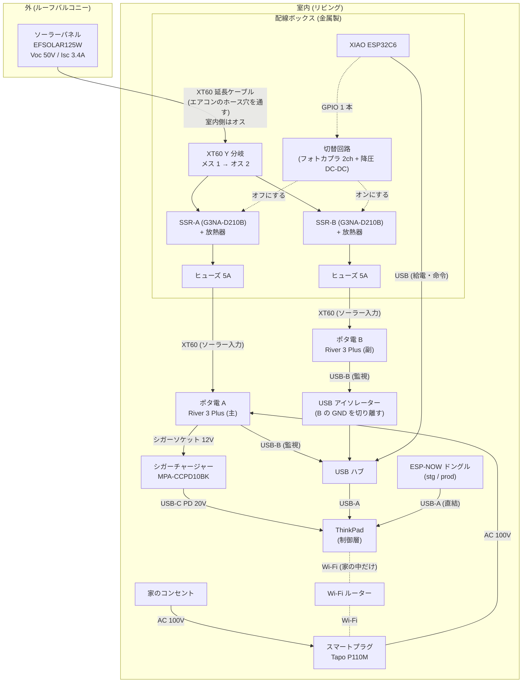
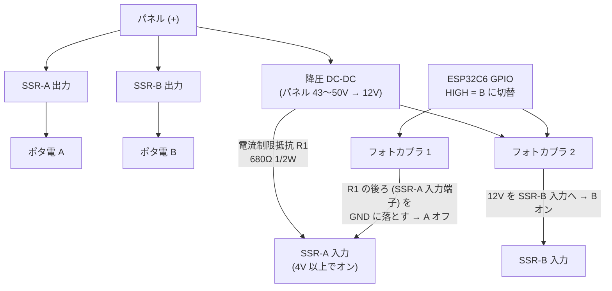

# 電源システム設計 (ソーラー + ポタ電 2 台 + ThinkPad)

FarmVerse サーバー (ThinkPad) を、ベランダのソーラーパネルと 2 台の EcoFlow River 3 Plus で動かす。
実装は [power/](../../power/) サブプロジェクト。

## 1. 目的と優先順位

1. **ThinkPad (制御層) を止めない。** ポタ電 A は ThinkPad 専用で、絶対に空にしない
2. **安全** (火災・感電・機器の破損を起こさない)。制御が壊れたときは安全側 (A に給電) に倒れる
3. **ソーラーの電気を捨てない。** A が満タンのときの余りを ThinkPad の内蔵バッテリーとポタ電 B に回す
4. 家の電気 (系統) は A の電池切れを防ぐ最後の手段として使う

## 2. 前提 (実測・仕様)

| 項目 | 値 | 出典 |
|---|---|---|
| パネル | EcoFlow EFSOLAR125W (両面)。Voc 50V、Vmp 43V、Isc 3.4A (BNPI) | EcoFlow ユーザーマニュアル |
| ポタ電 | EcoFlow River 3 Plus × 2 (A: 主、B: 副)。各 286Wh。ソーラー入力 11〜55V、13A、220W | EcoFlow 製品仕様 |
| パネルの Voc とポタ電の入力の上限 | Voc 50V < 上限 55V。寒い日は Voc が上がる (一般的な温度係数 −0.3%/℃ なら 0℃ で約 54V) ので余裕は小さい。冬の朝に入力電圧を記録して確かめる (§7) | |
| ThinkPad 本体の消費 | 3.8〜5.3W | 2026-11-23 バッテリー駆動中の実測 |
| A から出ていく量 (AC 出力 + Lenovo アダプター経由) | 約 11.7W (AC 出力の表示は約 8.2W) | 2026-11-22〜23 夜間の残量の減り方から |
| A は 0% で AC 出力を止め、充電が戻っても自動でオンにならない | | 2026-11-23 に発生 |
| A の AC 出力のオン・オフを NUT から操作できない (instcmd は shutdown 系のみ) | | `upscmd -l` |
| 1 枚のパネルに 2 台の MPPT を並列につなぐと、互いの MPPT が干渉して最適点に収束しない | | DIY Solar Forum (下記参考) |

## 3. 配線 (全体)

- **ポタ電 B は ThinkPad に給電しない。** ThinkPad の電源系統はポタ電 A だけにして単純にする。B は夏の余剰を貯める 2 台目の蓄電池で、停電時の予備・ほかの機器の電源にする
- **交流の電源を 2 つ、1 本の線に合流させない** (系統とポタ電の出力をソフトで切り替える配線は採用しない)
- ポタ電 A の AC 出力は冬は使わない (待機の損失をなくす)。ThinkPad は DC (シガーソケット) から給電する
- **ポタ電 B の監視 USB は USB アイソレーターを通す** (§4.2)

## 4. パネルの切替回路 (A か B のどちらか一方)

2 台の MPPT を並列につなぐと干渉するため、**パネルは常にどちらか一方だけ**につなぐ。

### 4.1 切替回路

- **降圧 DC-DC の出力を直接短絡しない。** SSR-A の入力の手前に電流制限抵抗 R1 を直列に入れ、フォトカプラ 1 は R1 の後ろ (SSR-A の入力端子側) を GND に落とす。短絡中に流れる電流は 12V / 680Ω ≒ 18mA (R1 の発熱 約 0.2W) に抑えられる
  - R1 の値: SSR の入力電流は最大 7mA (定電流入力)。オンのときの SSR 入力電圧は 12V − 7mA × 680Ω ≒ 7.2V で、動作電圧 (DC4V 以下) に対して余裕がある。短絡中はフォトカプラの飽和電圧 (約 0.2V) で、復帰電圧 (DC1V 以上) を下回る
- **SSR-B の入力にも降圧 DC-DC の 12V を使う** (USB 5V だとフォトカプラの電圧降下で約 4.8V になり、動作電圧 4V に対して余裕が少ない)。12V はパネルの電気なので、夜は A・B ともに自然にオフになる
- ESP32 (USB / ThinkPad 側) と SSR の入力回路 (パネル側) はフォトカプラで、SSR の入力と出力は SSR 内部で絶縁されている。制御回路を通じて A と B の GND がつながることはない

| 状態 | GPIO | SSR-A | SSR-B | パネルの行き先 |
|---|---|---|---|---|
| 通常 | LOW | オン | オフ | A |
| B へ振り分け | HIGH | オフ | オン | B |
| ESP32 / ThinkPad / USB が死んでいる | (出力なし) | **オン** (パネル自身の電気で入る) | オフ | **A** |
| 夜 (発電なし) | どちらでも | オフ | オフ | なし |

- **A 側は「パネルの電気でオン、制御がオフにしたときだけ切れる」。** 制御のどこが壊れても A に給電される (フェイルセーフ)
- **1 本の GPIO で A オフと B オンを同時に切り替える。** ソフトのバグで A と B が同時にオン (MPPT の並列) になることがない (ハードウェアでの相互排他)
  - 切替の瞬間は SSR の動作時間 (最大 1ms) と復帰時間 (最大 5ms) の差で、最大 5ms ほど A と B が両方パネルにつながる。両方ともソーラー**入力**で、ポタ電はソーラー入力から外へ電流を出さないので、ポタ電どうしの間に大電流は流れない (B の入力コンデンサーにパネルから突入電流が流れるだけで、パネルを手で挿すのと同じ)。並列の害は MPPT の収束の干渉で、5ms では問題にならない。切替は 10 分に 1 回以下 (§5)
- 機械式リレーではなく **SSR (半導体リレー) で直流 50V を切る。** 機械接点は直流 50V・3.4A を切るとアークが出る。G3NA-D210B は DC 5〜200V・10A 定格 (放熱器なしで 4A、40℃)
- SSR のオン電圧降下は最大 1.5V → 3.4A で約 5W の発熱。放熱器を付け、金属製のボックスに入れる
- **SSR の故障モードと検知。** SSR は「オンのまま固まる」壊れ方が多い
  - SSR-A がオンのまま: パネルが A に流れ続けるだけで、A 優先の設計どおり。危険はない
  - SSR-A がオフのまま: A に充電されない。A ≤ 15% でプラグ 1 が系統から充電するので ThinkPad は止まらない。昼間に A のソーラー入力が 0W のままなら通知する
  - **SSR-B がオンのまま: A と B が並列になる (避けたい状態)。** A と B のソーラー入力が同時に 0W を超えたら通知する。このため SSR-B は新品を使う

### 4.2 マイナス線と USB の GND (回り込み電流の防止)

パネルのマイナスは切り替えず、Y 分岐で A と B のソーラー入力 (−) に常時つながる。
一方、A と B の監視 USB はどちらも ThinkPad (USB ハブ) につながるので、USB の GND でも A と B がつながる。
River 3 Plus の内部でソーラー入力 (−) と USB の GND がつながっている (非絶縁) 場合、**パネルのマイナス線と USB の GND で輪 (グランドループ) ができ、ソーラーの戻り電流の一部が USB ケーブルや ThinkPad を流れる**おそれがある。

| 案 | 内容 | 評価 |
|---|---|---|
| **採用: B の監視 USB を USB アイソレーターで絶縁** | B ↔ ハブの間に USB アイソレーター (ADuM3160 系、USB フルスピード 12Mbps) を入れる。A と B の間の電気的なつながりはパネルのマイナスだけになる | 安価。電力の経路に部品を足さないので損失がない |
| 不採用: マイナス側も SSR で切り替える (2 極切替) | SSR を 4 個にする | 電圧降下が倍 (3V、約 10W の発熱)。部品も倍 |

- ThinkPad は A のシガーソケットからも給電され (シガーチャージャーは非絶縁)、A の監視 USB ともつながる。この輪 (A のシガー GND → チャージャー → ThinkPad → ハブ → A の USB GND) は両端が A 1 台の中なので、ソーラーの戻り電流の通り道にならない。戻り電流がこの輪を通るには、パネルのマイナスが A 以外 (B) を経由して ThinkPad 側につながる必要があり、それを B 側のアイソレーターで断っている。この輪に流れるのは A の内部の GND 間のわずかな電位差による電流だけ
- **組み立て前の確認 (§7):** ポタ電の電源を切った状態で、ソーラー入力 (XT60) の − と USB-B 端子の外側 (シールド) の間の導通をテスターで測り、結果をこの節に書き足す。導通がなければ (絶縁されていれば) アイソレーターは保険の扱いになる
- アイソレーターがフルスピード (12Mbps) までの対応なので、River の USB がフルスピードであることを `lsusb -t` で確かめる

## 5. 制御ルール

ThinkPad 上の常駐プログラム (`power/manager`) が 30 秒ごとに判断する。上から順に評価する。

| 優先 | 条件 | 動作 |
|---|---|---|
| 1 | A の残量 ≤ 15% | プラグ 1 をオン (系統で A を充電)。30% まで戻ったらオフ。パネルは A |
| 2 | ThinkPad の内蔵バッテリー < 40% | 40% まで充電 (停電への備え) |
| 3 | A ≥ 95% かつソーラーが余っている | まず ThinkPad を 80% まで充電。満ちたらパネルを B に切替。A が 90% まで下がるか、B が満タンなら A に戻す |
| 4 | それ以外 | パネルは A、プラグ 1 はオフ、ThinkPad は充電しない (今の残量を保つ) |

- 切替の往復を防ぐため、閾値にヒステリシスを持たせ、切替後 10 分は戻さない
- 常駐プログラムが止まったら: ESP32 は ThinkPad から一定時間 (例: 2 分) 命令が来なければ GPIO を LOW (パネルは A) に戻す。プラグ 1 は「電源復帰時オン」に設定する
- 通知: A の残量低下、A の AC / DC 出力の停止、ThinkPad のバッテリー駆動、切替・プラグ操作の失敗、SSR の固着 (§4.1)

## 6. 防火・安全対策

| 対策 | 内容 |
|---|---|
| 配線ボックス | **金属製** (鋼板) にする。Y 分岐・SSR・ヒューズ・切替回路・ESP32 をまとめて入れる。ケーブルはグランド (ケーブル用の穴の部品) を通し、引っ張っても端子に力がかからないようにする |
| ヒューズ | A・B それぞれのソーラー入力の手前に 5A。パネルの電流は最大 3.4A なので通常は切れない。ポタ電側からの逆流など配線の故障を想定 |
| 置き場所 | ポタ電 2 台とボックスは、燃えにくい面 (タイル・金属の台など) の上に置く。カーテンや紙類から離し、ポタ電の吸排気口をふさがない |
| ポタ電はボックスに入れない | 充電中に発熱するため、風通しを優先する |
| 火災警報器 | ポタ電の近くに住宅用火災警報器 (煙式) を付ける |
| 極性 | XT60 は差し込みの向きが決まっているが、自作の配線では極性を必ずテスターで確認してからつなぐ |
| 雨・結露 | 屋外にあるのはパネルと延長ケーブルだけ。ホース穴はパテでふさぎ、ケーブルは穴の手前で一度下に垂らす (水が伝って入らないようにする) |

## 7. 未確定事項・試験

1. **パネル 1 枚をポタ電 2 台に並列でつないだときの振る舞い** (§4 で並列をやめたので不要になったが、参考として手元で確認する場合は短時間・監視しながら行う)
2. ThinkPad X395 が MPA-CCPD10BK (PD 45W) から安定して給電されるか
3. G3NA-D210B の発熱 (3.4A 連続でボックス内の温度がどこまで上がるか)
4. River 3 Plus のソーラー入力が SSR 越し (電圧降下 1.5V) でも MPPT が正常に動くか
5. SSR の漏れ電流 (最大 5mA) がオフ側のポタ電の入力に影響しないか (オフ側の入力電圧が 0V 付近まで下がるか、オフ側のポタ電がソーラー入力ありと表示したり、スリープしなくなったりしないか)。影響があれば、各ポタ電のソーラー入力 (SSR の出力側) に並列にブリーダー抵抗 (例: 10kΩ 1W。50V で 5mA、0.25W) を足す
9. 冬の朝 (晴れて冷えた日) のパネルの開放電圧が 55V (River 3 Plus の上限) を下回るか。延長ケーブルをボックスから抜き、パネルの開放電圧をテスターで測る (SSR-A はパネルの電気で自動的にオンになるので、つないだままでは開放電圧にならない)
6. River 3 Plus のソーラー入力 (−) と USB の GND が内部でつながっているか (§4.2。電源を切ってテスターで導通を測る)
7. River 3 Plus の USB の速度 (フルスピード 12Mbps なら USB アイソレーターが使える)
8. SSR の受け入れ試験 (特に中古): 入力なしで出力端子間が導通しないこと、入力 12V でオンにして電圧降下が 1.5V 以下であること

## 8. 段階

| 段階 | 内容 | 必要な部品 |
|---|---|---|
| 1 | 電池切れ防止 (系統のスマートプラグ) と DC 給電 | §9 の 1・2 |
| 2 | ポタ電 B の監視 | §9 の 3〜5 |
| 3 | パネルを傾ける (南向き、冬 45° / 夏 20°) | §9 の「傾斜架台」 |
| 4 | パネルの A / B 切替 | §9 の 6〜16 |

## 9. 購入リスト

価格は 2026-11 時点の目安。

### 段階 1・2 (先に買う)

| # | 品名 | 数 | 目安 | URL |
|---|---|---|---|---|
| 1 | スマートプラグ TP-Link Tapo P110M (電力計測付き、python-kasa でローカル操作) | 1 (予備を入れて 2) | 約 1,700〜2,500 円 | [ヤマダ電機](https://www.yamada-denkiweb.com/7260301014/) / [Yahoo!](https://store.shopping.yahoo.co.jp/bouhansengen/tapo-p110m.html) |
| 2 | シガーチャージャー ELECOM MPA-CCPD10BK (USB PD 45W、20V 出力あり) | 1 | 約 4,000〜5,900 円 | [ビックカメラ](https://www.biccamera.com/bc/item/10717496/) / [ELECOM](https://www.elecom.co.jp/products/MPA-CCPD10BK.html) |
| 3 | USB ハブ (USB 2.0、4 ポート、セルフパワー推奨) | 1 | 約 1,000 円 | [Amazon で検索](https://www.amazon.co.jp/s?k=USB2.0+%E3%83%8F%E3%83%96+4%E3%83%9D%E3%83%BC%E3%83%88) |
| 4 | USB-A to USB-B ケーブル (ポタ電 B の監視用) | 1 | 約 500 円 | [Amazon で検索](https://www.amazon.co.jp/s?k=USB+A-B+%E3%82%B1%E3%83%BC%E3%83%96%E3%83%AB+2m) |
| 5 | USB アイソレーター (ADuM3160 系、絶縁電源内蔵、USB フルスピード) | 1 | 約 2,000〜4,000 円 | [Amazon で検索](https://www.amazon.co.jp/s?k=USB+%E3%82%A2%E3%82%A4%E3%82%BD%E3%83%AC%E3%83%BC%E3%82%BF+ADuM3160) |

### 段階 4 (配線ボックス一式。§7 の試験の後でよい)

| # | 品名 | 数 | 目安 | URL |
|---|---|---|---|---|
| 6 | SSR-A: オムロン G3NA-D210B (旧型、中古、放熱器 Y92B-N50 付き) | 1 | 2,200 円 + 送料 | [Yahoo! (growdetradingltd)](https://store.shopping.yahoo.co.jp/growdetradingltd/jcpr41123b007.html) |
| 7 | SSR-B: オムロン **G3NA-D210B-UTU DC5-24** (新品。G3NA-D210B の後継、定格は同じ) | 1 | 約 4,300〜5,500 円 | [TERUYA Online](https://store.shopping.yahoo.co.jp/teruya-online/g3na1088h.html) / [マルツ](https://www.marutsu.co.jp/pc/i/2533233/) / [オムロン](https://www.fa.omron.co.jp/product/item/G3NA-D210B-UTU_DC5-24/) |
| 8 | 放熱器 オムロン Y92B-N50 (SSR-B 用) | 1 | 約 1,500 円 | [モノタロウ G3NA 関連](https://www.monotaro.com/g/00112977/) |
| 9 | 降圧 DC-DC モジュール (入力 60V 以上に対応、出力 12V) | 1 | 約 1,000 円 | [Amazon で検索](https://www.amazon.co.jp/s?k=DC-DC+%E9%99%8D%E5%9C%A7+%E5%85%A5%E5%8A%9B60V+12V) |
| 10 | フォトカプラ モジュール (PC817、2ch) | 1 | 約 500 円 | [Amazon で検索](https://www.amazon.co.jp/s?k=PC817+%E3%83%95%E3%82%A9%E3%83%88%E3%82%AB%E3%83%97%E3%83%A9+%E3%83%A2%E3%82%B8%E3%83%A5%E3%83%BC%E3%83%AB) |
| 11 | 抵抗 680Ω 1/2W (R1、電流制限) | 数本 | 約 100 円 | [Amazon で検索](https://www.amazon.co.jp/s?k=%E6%8A%B5%E6%8A%97+680%CE%A9+1%2F2W) |
| 12 | 直流用ヒューズ 5A とインラインホルダー | 2 | 約 1,000 円 | [Amazon で検索](https://www.amazon.co.jp/s?k=%E3%83%92%E3%83%A5%E3%83%BC%E3%82%BA%E3%83%9B%E3%83%AB%E3%83%80%E3%83%BC+%E3%82%A4%E3%83%B3%E3%83%A9%E3%82%A4%E3%83%B3) |
| 13 | XT60 Y 分岐 HADEFA (メス 1 → オス 2、14AWG、10cm) | 1 | 約 1,000 円 | [Amazon](https://www.amazon.co.jp/dp/B0H4QQ4JDG) |
| 14 | XT60 ピッグテール (オス・メス) | 各 2 | 約 1,000 円 | [Amazon で検索](https://www.amazon.co.jp/s?k=XT60+%E3%83%94%E3%83%83%E3%82%B0%E3%83%86%E3%83%BC%E3%83%AB) |
| 15 | 金属製の配線ボックス (ケーブルグランド付き。放熱器付き SSR が 2 個入る大きさ) | 1 | 約 2,000〜4,000 円 | [Amazon で検索](https://www.amazon.co.jp/s?k=%E3%82%B9%E3%83%81%E3%83%BC%E3%83%AB%E3%83%9C%E3%83%83%E3%82%AF%E3%82%B9+%E9%9B%BB%E6%B0%97) |
| 16 | 住宅用火災警報器 (煙式) | 1 | 約 2,000〜3,000 円 | [Amazon で検索](https://www.amazon.co.jp/s?k=%E4%BD%8F%E5%AE%85%E7%94%A8%E7%81%AB%E7%81%BD%E8%AD%A6%E5%A0%B1%E5%99%A8+%E7%85%99%E5%BC%8F) |
| — | XIAO ESP32C6 | 1 | 手持ち | — |

- SSR-A だけ中古にする理由: SSR-A が壊れても A 側に倒れる (§4.1)。SSR-B は固着すると A と B が並列になるので新品にする
- 「G3NA-D210B-UTU **AC100-240**」(入力が交流) と「G3NA-**210B**-UTU」(D なし、交流負荷用) は使えない。型番に「D210B」「UTU」「DC5-24」がすべて入っていることを確認する

### 段階 3 (傾斜架台)

| 品名 | 数 | 備考 |
|---|---|---|
| 直管パイプ 25.4mm 800mm | 2 | レール |
| 直管パイプ 25.4mm 900mm を 750mm + 150mm にカット | 2 | つっかえ棒 (750mm で 20°〜約 49°) |
| 自在クランプ 25.4 | 6 | [モノタロウ](https://www.monotaro.com/g/01603502/) |
| ミニクランプ (平和技研 ミニクラ Φ25.4×Φ25.4) | 2 | [Amazon](https://www.amazon.co.jp/dp/B0DDSC8M3H) |
| ステンレス シャコ万力 | 4 | |
| EPDM ゴムシート | 1 | 枠とレール、枠と万力の間 |

## 参考

- [EcoFlow RIVER 3 Plus 製品仕様 (ソーラー入力 11〜55V、13A、220W)](https://eu.ecoflow.com/products/river-3-plus-portable-power-station)
- [EcoFlow 125W Bifacial Modular Solar Panel User Manual](https://www.santansolar.com/wp-content/uploads/EcoFlow-125W-Bifacial-Modular-Solar-Panel_User-Manual_en.pdf)
- [DIY Solar Forum: One 400W solar panel to 2 power stations?](https://diysolarforum.com/threads/one-400w-solar-panel-to-2-power-stations.85857/)
- [オムロン G3NA-D210B-UTU DC5-24](https://www.fa.omron.co.jp/product/item/G3NA-D210B-UTU_DC5-24/)
- [python-kasa Supported devices](https://python-kasa.readthedocs.io/en/stable/SUPPORTED.html)
