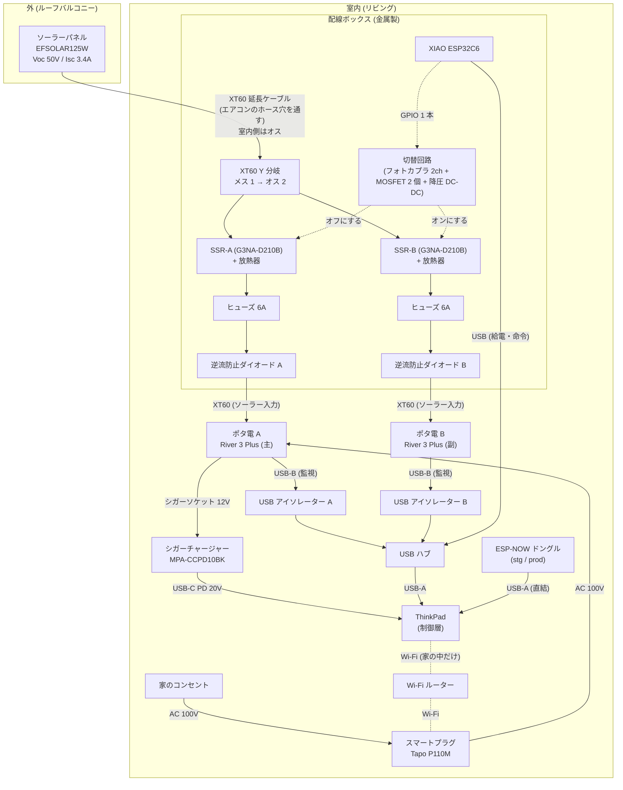
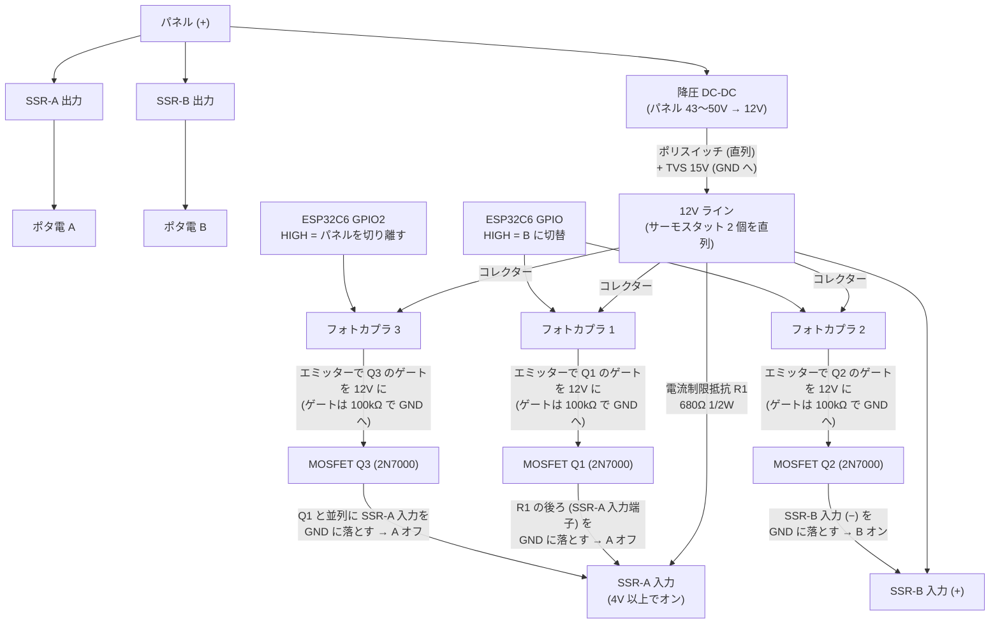

# 電源システム設計 (ソーラー + ポタ電 2 台 + ThinkPad)

FarmVerse サーバー (ThinkPad) を、ベランダのソーラーパネルと 2 台の EcoFlow River 3 Plus で動かす。
実装は [power/](../../power/) サブプロジェクト。

## 1. 目的と優先順位

1. **ThinkPad (制御層) を止めない。** ポタ電 A は ThinkPad 専用で、絶対に空にしない
2. **安全** (火災・感電・機器の破損を起こさない)。制御が壊れたときは安全側 (A に給電) に倒れる
3. **ソーラーの電気を捨てない。** A が満タンのときの余りを ThinkPad の内蔵バッテリーとポタ電 B に回す
4. 家の電気 (系統) は A の電池切れを防ぐ最後の手段として使う

## 2. 前提 (実測・仕様)

| 項目 | 値 | 出典 |
|---|---|---|
| パネル | EcoFlow EFSOLAR125W (両面)。Voc 50V、Vmp 43V、Isc 3.4A (BNPI) | EcoFlow ユーザーマニュアル |
| ポタ電 | EcoFlow River 3 Plus × 2 (A: 主、B: 副)。各 286Wh。ソーラー入力 11〜55V、13A、220W | EcoFlow 製品仕様 |
| パネルの Voc とポタ電の入力の上限 | Voc 50V < 上限 55V。寒い日は Voc が上がる (一般的な温度係数 −0.3%/℃ なら 0℃ で約 54V、−2℃ で約 54.1V、−5℃ で約 54.5V、−9℃ で約 55.1V) ので余裕は小さい。対策は下記 | |
| ThinkPad 本体の消費 | 3.8〜5.3W | 2026-11-23 バッテリー駆動中の実測 |
| A から出ていく量 (AC 出力 + Lenovo アダプター経由) | 約 11.7W (AC 出力の表示は約 8.2W) | 2026-11-22〜23 夜間の残量の減り方から |
| A は 0% で AC 出力を止め、充電が戻っても自動でオンにならない | | 2026-11-23 に発生 |
| A の AC 出力のオン・オフを NUT から操作できない (instcmd は shutdown 系のみ) | | `upscmd -l` |
| 1 枚のパネルに 2 台の MPPT を並列につなぐと、互いの MPPT が干渉して最適点に収束しない | | DIY Solar Forum (下記参考) |

**冬の Voc が 55V を超えないための対策。** 上限を超えてから測ったのでは遅い (入力回路が壊れる) ので、次を事前に行う。

- 設置場所は東京 (新宿)。東京の最低気温は例年 −1〜−2℃ 程度で、この 50 年の最低は 2018-01-25 の −4℃ (上の計算で約 54.4V)。上限を超える −9℃ 以下は、この 50 年に記録がない
- 上の計算はパネルのセル温度 = 気温として、強い日射の下での Voc を見積もった安全側の値。実際は、日の出直後は日射が弱く Voc は STC (1000W/m²) より低い。日射が強くなるとセルが日射で温まり、気温より高くなる
- それでも余裕が小さいので、**天気予報の最低気温が −2℃ 以下の日は、前の晩にパネルを自動で切り離し** (§4.1 の GPIO2、§5)、昼に気温が上がってからつなぎ直す (年に数回あるかどうか)。人がケーブルを抜く運用にはしない (旅行中や忘れたときに守れない)。段階 4a より前 (切替回路がない間) だけは、前の晩に延長ケーブルの XT60 をポタ電から抜く
- 冬になる前 (2026-12 の冷えた晴れの朝) に、パネルの開放電圧を測って温度係数を確かめる (§7 の 9)。53V を超えるようなら、パネルを Voc の低いもの (直列セル数の少ないもの) に替えるか、入力上限の高いポタ電にする

## 3. 配線 (全体)



- **ポタ電 B は ThinkPad に給電しない。** ThinkPad の電源系統はポタ電 A だけにして単純にする。B は夏の余剰を貯める 2 台目の蓄電池で、停電時の予備・ほかの機器の電源にする
- **交流の電源を 2 つ、1 本の線に合流させない** (系統とポタ電の出力をソフトで切り替える配線は採用しない)
- ポタ電 A の AC 出力は冬は使わない (待機の損失をなくす)。ThinkPad は DC (シガーソケット) から給電する
- **ポタ電 A・B の監視 USB は、どちらも USB アイソレーターを通す** (§4.2)。ThinkPad 側とポタ電がつながるのは、A のシガーソケット 1 か所だけになる

## 4. パネルの切替回路 (A か B のどちらか一方)

2 台の MPPT を並列につなぐと干渉するため、**パネルは常にどちらか一方だけ**につなぐ。

### 4.1 切替回路



- **降圧 DC-DC の出力を直接短絡しない。** SSR-A の入力の手前に電流制限抵抗 R1 を直列に入れ、Q1 は R1 の後ろ (SSR-A の入力端子側) を GND に落とす。短絡中に流れる電流は 12V / 680Ω ≒ 18mA (R1 の発熱 約 0.2W) に抑えられる
  - R1 の値: SSR の入力電流は最大 7mA (定電流入力)。オンのときの SSR 入力電圧は 12V − 7mA × 680Ω ≒ 7.2V で、動作電圧 (DC4V 以下) に対して余裕がある。短絡中は Q1 のオン抵抗 (2N7000 はゲート 10V で最大 5Ω) で 18mA × 5Ω ≒ 0.09V になり、復帰電圧 (DC1V 以上) を下回る
- **SSR の入力電流はフォトカプラで直接流さず、MOSFET (Q1・Q2) で流す。** 市販のフォトカプラ モジュールは入力 (LED) 側に 1kΩ 前後の抵抗が付いていることが多く、ESP32 の 3.3V では LED の電流が (3.3V − 1.2V) / 1kΩ ≒ 2mA にしかならない。PC817 の CTR (電流伝達率) は最小 50% なので、フォトカプラの出力で流せるのは 1mA 程度で、SSR-A を切るための 18mA や SSR-B の入力電流 7mA には足りない。足りないとフォトカプラが飽和せず、SSR-A の入力が復帰電圧 (1V) まで下がらない (A が切れずに並列になる) か、SSR-B の入力が動作電圧 (4V) に届かない (半オンで発熱する、下記)
  - フォトカプラはエミッターフォロワーで MOSFET のゲートを駆動する (コレクターを 12V、エミッターをゲートと 100kΩ のプルダウンにつなぐ)。フォトカプラの出力電流は 12V / 100kΩ ≒ 0.12mA で、CTR が最小でも十分に飽和する。ゲート電圧は約 12V で、2N7000 の上限 (±20V) より低い
  - **モジュールの出力側の回路を確認する。** 出力にプルアップ抵抗や LED が付いていてコレクターとエミッターを別々に取り出せない製品は、そのままでは使えない (届いたらパターンを見て、必要なら部品を外す)
    - **単体部品に切り替える基準:** 次のどれかに当てはまるモジュールは使わず、単体の PC817 (DIP) で組む
      - 入力側と出力側の GND がつながっていて、切り離せない
      - 出力のコレクターとエミッターを別々に取り出せない
      - 出力側の部品 (プルアップ抵抗・LED) を外すとパターンが切れる
    - 単体で組むときは、ESP32 の GPIO → 1kΩ → PC817 のアノード、カソード → ESP32 の GND とする。LED の電流は約 2mA で、エミッターフォロワーの出力 (0.12mA) には十分
  - **Q1・Q2 の向き:** どちらもソースを GND (降圧 DC-DC の GND)、ドレインを切り替える側につなぐ
    - Q1: ドレインを R1 と SSR-A の入力 (+) の間につなぐ。SSR-A の入力 (−) は GND
    - Q2: ドレインを SSR-B の入力 (−) につなぐ。SSR-B の入力 (+) は 12V ライン
    - SSR の入力は 2 端子の定電流回路なので、− 側で切っても + 側で切っても動作は同じ。ただし実物で確かめる (§7 の 12)
  - Q1・Q2 の故障も、フォトカプラの故障と同じ検知で扱う: Q1 のオープン (A が切れない) はフォトカプラ 1 のオープン故障と、Q2 のショート (B が入りっぱなし) は SSR-B の固着と同じ結果になる。Q1 のショート (A が入らない) は「SSR-A がオフのまま」と同じ。Q2 のオープン (B に切り替えても B が入らない) は、B に切り替えて 1 分たっても B のソーラー入力が 0W のままなら A に戻して通知する (下の「SSR の故障モードと検知」)
- **SSR-B の入力にも降圧 DC-DC の 12V を使う** (USB 5V だと電圧降下で動作電圧 4V に対して余裕が少ない)。12V はパネルの電気なので、夜は A・B ともに自然にオフになる
- **朝夕・曇天で 12V がゆっくり上下するとき (SSR の入力が中途半端な電圧になるとき)。** SSR の入力が動作電圧 (4V) と復帰電圧 (1V) の間にあると、出力素子が半オンになって電圧降下が大きくなり、電流が流れると強く発熱する
  - 通常はこの状態で電流が流れない。SSR-A の入力が 4V を下回るのは降圧 DC-DC の出力が約 8.8V (4V + 7mA × 680Ω) 以下のとき、つまりパネルの電圧が約 10V 以下のときで、River 3 Plus はソーラー入力 11V 未満では受電しない (§2)。このときパネルの出せる電力もごくわずか
  - 危ないのは**降圧 DC-DC が「出力が下がる」形で壊れた**とき。晴れた日に SSR が半オンのまま Isc (3.4A) が流れうる。このため、**SSR-A・SSR-B の放熱器にそれぞれバイメタル式サーモスタット (常時閉、70℃ で開く。KSD301 など) を付け、2 個を直列にして降圧 DC-DC の 12V 出力 (R1・SSR-B の入力・フォトカプラのコレクターの手前) に入れる。** どちらかの SSR が熱くなると 12V が切れ、A・B ともオフになる (パネルはどこにもつながらない)。A は §5 のプラグ 1 で守られ、昼に A のソーラー入力が 0W のままになるので通知される (下の「SSR の故障モードと検知」)
  - 低電圧誤動作防止の回路 (電圧監視 IC で 12V が 10V を超えるまで SSR の入力を 0V に保つ) は採用しない。通常時は上のとおり不要で、降圧 DC-DC の故障にはサーモスタットで足りる。部品を増やすと、その故障で A がオフになる道が増える
    - 朝はポタ電が受電しない (11V 未満) ので、パネルは開放電圧のまま。開放電圧はわずかな光で急に上がる (曇りの朝でも数分で 30V 台) ため、12V が中途半端な電圧にとどまるのは、パネルがほとんど電流を出せない時間だけ
    - 夕方や MPPT の探索 (入力電圧を一時的に下げて最適点を探す動き) でパネルの電圧が下がり、SSR-A の入力が 4V を割りかけたとき: SSR-A の電圧降下が増えると、SSR-A の手前 (パネル側) の電圧が上がり、そこから作る 12V も上がって SSR-A をオンに戻す向きに働く (降圧 DC-DC はパネル側から給電している)。半オンが続くのは、パネルが電圧を保てないほど電流が小さいときだけで、発熱は放熱器の設計値 (5W) より十分小さい
    - この見込みは §7 の 13 で実測して確かめる。半オンで SSR が熱くなる様子が見えたら、低電圧誤動作防止の回路を入れる
- ESP32 (USB / ThinkPad 側) と SSR の入力回路 (パネル側) はフォトカプラで、SSR の入力と出力は SSR 内部で絶縁されている。制御回路を通じて A と B の GND がつながることはない
  - 降圧 DC-DC の GND はパネルのマイナス (= A・B のソーラー入力 (−)) と同じ電位になる。降圧 DC-DC の入出力はすべてパネル側にあり、ESP32 側とはフォトカプラの絶縁だけで隔てられているので、非絶縁の降圧 DC-DC でよい
  - **降圧 DC-DC は入力 80V 以上に対応したものを使う** (XL7015 など、入力 5〜80V の品)。パネルの電圧は冬に約 54V (§2) まで上がり、入力 60V の品 (LM2596HV など) では余裕が 10% ほどしかない。安価なモジュールは入力コンデンサーの耐圧もぎりぎりのことがある (届いたらコンデンサーの耐圧表示を確認する)
  - 降圧 DC-DC の入力の手前 (パネル側) に 1A のヒューズ (gPV、§6) を入れる。降圧 DC-DC が入力短絡の形で壊れると、パネルの Isc (3.4A) がモジュールに流れ続けて発熱するため。降圧 DC-DC の消費は数十 mA なので、1A で通常は切れない
  - **降圧 DC-DC が入力と出力の間で短絡する形で壊れたときに備え、12V 出力にポリスイッチ (PTC) と 15V の TVS ダイオードを入れる。** 順番は 降圧 DC-DC の出力 → ポリスイッチ (直列) → TVS (12V と GND の間、カソードを 12V 側) → サーモスタット → R1・SSR・フォトカプラ。短絡するとパネルの電圧 (最大約 55V) が 12V ラインにかかり、そのままだと R1 は 55V / 680Ω ≒ 81mA・約 4.4W (定格 1/2W の約 9 倍) で焼け、SSR の入力 (定格 DC5〜24V) と Q1・Q2 のゲート (上限 ±20V) も壊れる。12V ラインの消費は 30mA 程度なので、1A の入力ヒューズは切れない
    - TVS ダイオード (1.5KE15A、単方向、降伏電圧 14.3〜15.8V、ピークパルス電力 1500W (1ms)、定常 5W) が 12V ラインを約 15〜17V に抑え、パネルの電流 (最大 Isc 3.4A) は TVS へ流れる。ポリスイッチ (保持電流 0.1A 前後) は 3.4A で短時間 (1 秒以内) に切れ、その後は数 mA だけを通すので、TVS が過熱しない。15V のとき R1 の発熱は約 0.33W で定格内
    - ツェナーダイオード (1N5352B など、定常 5W) は使わない。ポリスイッチが切れるまでの数十 ms〜1 秒、約 15V × 3.4A ≒ 51W がかかり、ツェナーのサージ耐量 (8.3ms の単発が前提) を超えるおそれがある。TVS はこの種の短時間の大電力を吸収するための部品で、パルス幅が長くなると許容電力が下がる (おおむね時間の平方根に反比例) が、100ms で約 150W、1 秒で約 50W と見込める。ポリスイッチが 1 秒以内に切れることは §7 の 12 で、安定化電源の電流制限を 3.4A にして確かめる
    - TVS もツェナーも、壊れるときは短絡になることが多い。その場合はポリスイッチが切れたままになり 12V ラインが落ちる (A・B ともオフ)。昼に A のソーラー入力が 0W のままになるので通知される
    - TVS だけで入力の 1A ヒューズを切る案は採用しない。gPV ヒューズは 1A × 3.4 倍の電流では切れるまで時間がかかり、その間 TVS に 15V × 3.4A ≒ 51W がかかり続けて先に壊れる
    - **ポリスイッチは最大電圧 60V 以上の品を使う** (Bourns MF-R010 (60V、保持 0.1A) など。72V 品ならなお良い)。切れたポリスイッチにはパネルの電圧がほぼそのままかかる
    - **降圧 DC-DC の出力電圧は、ボックスに組む前に安定化電源で 12V に合わせる。** 可変のモジュールは出荷時の出力電圧がまちまちで、TVS の常時印加電圧 (1.5KE15A は 12.8V) を超えていると TVS が電流を流して熱くなる。12.0V に合わせる
  - **フォトカプラ モジュールの入力側 GND と出力側 GND がつながっていないことを確認する。** 市販のモジュールには両側の GND を共通にした (ジャンパーやパターンでつないだ) 製品がある。つながっていると、パネルのマイナス → 降圧 DC-DC の GND → モジュール → ESP32 → USB ハブ → ThinkPad → シガーチャージャー → A のシガー GND という輪ができ、ソーラーの戻り電流が ThinkPad 側を流れるおそれがある (§4.2)。組み立て前にテスターで両側の GND 間が導通しないことを測る (§7)

| 状態 | GPIO | SSR-A | SSR-B | パネルの行き先 |
|---|---|---|---|---|
| 通常 | LOW | オン | オフ | A |
| B へ振り分け | HIGH | オフ | オン | B |
| ESP32 / ThinkPad / USB が死んでいる | (出力なし) | **オン** (パネル自身の電気で入る) | オフ | **A** |
| 夜 (発電なし) | どちらでも | オフ | オフ | なし |
| パネルを切り離す (寒い朝の過電圧の予防、§2) | LOW (GPIO2 は HIGH) | オフ | オフ | なし |

- **A 側は「パネルの電気でオン、制御がオフにしたときだけ切れる」。** 制御のどこが壊れても A に給電される (フェイルセーフ)
- **1 本の GPIO で A オフと B オンを同時に切り替える。** ソフトのバグで A と B が同時にオン (MPPT の並列) になることはない。ただし部品 1 個の故障までは防げない: フォトカプラ 1 がオープン故障 (内部の破損、ハンダ割れ、断線) すると、GPIO を HIGH にしても SSR-A は切れず、SSR-B だけがオンになって並列になる。これは SSR-B のオン固着と同じ結果なので、同じ検知で扱う (下の「SSR の故障モードと検知」)
  - 切替の瞬間は SSR の動作時間 (最大 1ms) と復帰時間 (最大 5ms) の差で、最大 5ms ほど A と B が両方パネルにつながる。両方ともソーラー**入力**で、ポタ電がソーラー入力から外へ電流を出さなければ (§7 で確認する)、ポタ電どうしの間に大電流は流れない (B の入力コンデンサーにパネルから突入電流が流れるだけで、パネルを手で挿すのと同じ)。並列の害は MPPT の収束の干渉で、5ms では問題にならない。切替は 10 分に 1 回以下 (§5)
  - A の入力コンデンサーにたまった電気が B 側へ流れることもない。逆流防止ダイオード (§6、必須) が各ポタ電のソーラー入力の手前に直列に入っているため。**ダイオードを付けないまま切替の試験をしない** (§7)
  - GPIO を 2 本にして「A をオフ → 待つ → B をオン」とする案は採用しない。ソフトのバグや ESP32 の起動直後・リセット中のピンの状態で、A と B が同時にオンになる道ができるため。5ms の重なりはダイオードがあれば害がない
- **パネルを切り離す 2 本目の GPIO (GPIO2)。** 寒い朝にパネルの開放電圧がポタ電の入力の上限 (55V) に近づくとき (§2) に、A・B ともオフにするため
  - GPIO2 → フォトカプラ 3 → Q3 で、Q1 と並列に SSR-A の入力を GND に落とす。切替の GPIO を LOW (B オフ) にしたまま GPIO2 を HIGH にすると、A・B ともオフになる
  - **GPIO2 にできるのは「A をオフにする」ことだけで、B をオンにはできない。** GPIO2 のバグや起動中のピンの状態で A と B が同時にオンになることはない (1 本の GPIO で切り替える相互排他はそのまま)
  - フェイルセーフも変わらない。GPIO2 が LOW かハイインピーダンス (ESP32 の起動中・故障) ならパネルは A につながる。ESP32 の見張り (命令が 2 分途絶えたら LOW、§5) も GPIO2 を LOW に戻す
  - 寒い朝に ESP32 か ThinkPad が止まっていると、切り離せずに A につながる。2 つの故障が重なったときだけ起きるので受け入れる (東京では年に数回あるかどうかの寒さ、§2)
- **ESP32C6 の GPIO のピンの選び方。** 起動時・リセット中・書き込み中にピンが HIGH にならず、外付けの回路で起動の仕方が変わらないピンを使う
  - **切替に XIAO ESP32C6 の D4 (GPIO22)、パネルの切り離し (GPIO2) に D5 (GPIO23) を使う。** どちらもプルダウン抵抗 10kΩ を付ける
  - 次のピンは避ける。
    - ストラップピン (GPIO4・GPIO5・GPIO8・GPIO9・GPIO15)
    - UART0 (GPIO16・GPIO17。起動時にログを出す)
    - USB (GPIO12・GPIO13)
    - XIAO のアンテナ切替 (GPIO3・GPIO14)
    - D4 = GPIO22、D5 = GPIO23、アンテナ切替 = GPIO3・GPIO14 は Seeed の公式ピン配置 (https://wiki.seeedstudio.com/xiao_esp32c6_getting_started/) で確認済み
  - GPIO はフォトカプラの LED のアノード側を抵抗経由で駆動する (カソードは ESP32 の GND)。GPIO が LOW でもハイインピーダンス (起動中・リセット中・書き込み中・ESP32 の故障) でも LED は消え、パネルは A になる。ピンが浮かないよう、GPIO と GND の間に 10kΩ のプルダウン抵抗を入れる
  - ファームウェアは起動したら最初にピンを LOW の出力にする (§7 の 14 で、リセットと書き込みの最中に A が切れないことを確かめる)
- 機械式リレーではなく **SSR (半導体リレー) で直流 50V を切る。** 機械接点は直流 50V・3.4A を切るとアークが出る。G3NA-D210B は DC 5〜200V・10A 定格 (放熱器なしで 4A、40℃)
- SSR のオン電圧降下は最大 1.5V → 3.4A で約 5W の発熱。放熱器を付け、金属製のボックスに入れる
  - 逆流防止ダイオード (§6) の約 1.7W と合わせて、ボックスの中で最大約 6.7W が熱になる (通電しているのは SSR 1 個とダイオード 1 個だけなので、2 系統分の合計ではない)。密閉したボックスの中で放熱器だけに頼ると、熱がこもってボックス内の温度が上がる
  - **SSR とダイオードの放熱器はボックスの壁 (鋼板) に直接ねじ止めし、ボックスごと外気へ逃がす** (接触面に放熱シートか放熱グリスを使う)。ESP32・降圧 DC-DC・フォトカプラは放熱器から離し、ボックスの下側 (熱が上にたまるので) に置く。ボックスは直射日光の当たらない所に置く
  - ボックス内の温度を ESP32 で測り (温度センサーを 1 個足す。ESP32C6 の内蔵温度センサーはチップ自身の温度なので目安にとどめる)、50℃ を超えたら通知する。サーモスタット (70℃) が開く前に気づける
  - SSR の代わりにパワー MOSFET のスイッチ、ダイオードの代わりに理想ダイオード IC を使うと、電圧降下と発熱をほぼなくせる。ただし MOSFET を正側 (ハイサイド) で駆動するには、パネル側に浮いたゲート駆動電源が要り、部品と故障の道が増える。今回は SSR とショットキーダイオードで組み、§7 の 3 の試験でボックス内の温度が収まらないときに検討する
- **SSR の故障モードと検知。** SSR は「オンのまま固まる」壊れ方が多い
  - SSR-A がオンのまま: パネルが A に流れ続けるだけで、A 優先の設計どおり。危険はない
  - SSR-A がオフのまま: A に充電されない。A ≤ 15% でプラグ 1 が系統から充電するので ThinkPad は止まらない。昼間に A のソーラー入力が 0W のままなら通知する
  - **SSR-B がオンのまま: A と B が並列になる (避けたい状態)。** A と B のソーラー入力が同時に 0W を超えたら通知する。このため SSR-B は新品を使う
  - **フォトカプラ 1 か Q1 のオープン故障 (B に切り替えても SSR-A が切れない): 同じく並列になる。** B に切り替えたら、1 分以内に A のソーラー入力が 0W になったことを確かめる。0W にならなければ GPIO を LOW (A) に戻し、通知して、点検するまで B への切替を止める。並列が続くのは最大 1 分で、ポタ電どうしの逆流は §6 の逆流防止ダイオード (必須) で防ぐので、この間の害は MPPT の干渉 (発電量が落ちる) だけ
  - SSR-B が入らない (フォトカプラ 2・Q2 のオープン故障など): B に切り替えると A が切れてパネルがどこにもつながらない。B に切り替えて 1 分たっても B のソーラー入力が 0W のままなら (日射があるのに)、A に戻して通知する
  - 部品の故障を回路で防ぐ相互排他 (C 接点の機械式リレーで A と B の一方だけを選ぶなど) は採用しない。機械接点は直流 50V・3.4A を切るとアークが出るため (下記)、半導体で同じことをすると部品と発熱が増えるため。逆流防止ダイオード (§6) で故障の結果を「発電量の低下」にとどめ、検知と自動の戻しで扱う
    - 並列になったとき、ポタ電がソーラー入力へ逆に電流を出すと、一方のポタ電から他方へ電流が流れる。§7 の 10 (入力を開放したときの電圧) で確かめられるのは 1 つの状態だけで、夕方にパネルの電圧がポタ電の電池の電圧より下がった時間帯などは確かめきれない。このため逆流防止ダイオードは試験の結果によらず必ず入れる (§6)

### 4.2 マイナス線と USB の GND (回り込み電流の防止)

パネルのマイナスは切り替えず、Y 分岐で A と B のソーラー入力 (−) に常時つながる。
一方、A と B の監視 USB はどちらも ThinkPad (USB ハブ) につながるので、USB の GND でも A と B がつながる。
River 3 Plus の内部でソーラー入力 (−) と USB の GND がつながっている (非絶縁) 場合、**パネルのマイナス線と USB の GND で輪 (グランドループ) ができ、ソーラーの戻り電流の一部が USB ケーブルや ThinkPad を流れる**おそれがある。

| 案 | 内容 | 評価 |
|---|---|---|
| **採用: A・B の監視 USB を USB アイソレーターで絶縁** | A ↔ ハブ、B ↔ ハブの間にそれぞれ USB アイソレーター (ADuM3160 系、USB フルスピード 12Mbps) を入れる。A と B の間の電気的なつながりはパネルのマイナスだけ、ThinkPad とポタ電のつながりは A のシガーソケットだけになる | 安価。電力の経路に部品を足さないので損失がない |
| 不採用: マイナス側も SSR で切り替える (2 極切替) | SSR を 4 個にする | 電圧降下が倍 (3V、約 10W の発熱)。部品も倍 |

- **A 側にもアイソレーターを入れる理由。** ThinkPad は A のシガーソケットから給電され (シガーチャージャーは非絶縁)、A の監視 USB ともつながるので、A のシガー GND → チャージャー → ThinkPad → ハブ → A の USB GND という輪ができる
  - この輪は両端が A のシステム GND で、ソーラー入力 (−) を通らない。パネルのマイナスが A 以外 (B) を経由して ThinkPad 側につながらない限り、ソーラーの戻り電流の通り道にはならない
  - ただし **ThinkPad の給電の戻り電流 (シガーソケット側で最大約 4A) が、チャージャーの GND と USB ケーブルの GND に分かれて流れる。** USB ケーブル・ハブの GND は細いので、この分流をなくす
  - A の監視 USB はスマートプラグ (§5 の優先 1) の判断材料なので、アイソレーターの故障で A の残量が読めなくなったときは、安全側 (プラグ 1 をオン) に倒す (§5)
- **組み立て前の確認 (§7):** ポタ電の電源を切った状態で、ソーラー入力 (XT60) の − と USB-B 端子の外側 (シールド) の間の導通をテスターで測り、結果をこの節に書き足す。導通がなければ (絶縁されていれば) アイソレーターは保険の扱いになる
- アイソレーターはフルスピード (12Mbps) までの対応。River 3 Plus の USB はフルスピードで認識されている (2026-11-27 の ThinkPad のカーネルログ `new full-speed USB device`、ID 3746:ffff)
- アイソレーターは届いたら、入力側と出力側の端子の外側 (シールド) どうし、GND ピン (4 番) どうしが導通しないことをテスターで確かめる (§7)

## 5. 制御ルール

ThinkPad 上の常駐プログラム (`power/manager`) が 30 秒ごとに判断する。上から順に評価する。

| 優先 | 条件 | 動作 |
|---|---|---|
| 1 | A の残量 ≤ 15% | プラグ 1 をオン (系統で A を充電)。30% まで戻ったらオフ。パネルは A |
| 2 | ThinkPad の内蔵バッテリー < 40% | 40% まで充電 (停電への備え) |
| 3 | A ≥ 95% かつソーラーが余っている | まず ThinkPad を 80% まで充電。満ちたらパネルを B に切替。A が 90% まで下がるか、B が満タンなら A に戻す |
| 4 | それ以外 | パネルは A、プラグ 1 はオフ、ThinkPad は充電しない (今の残量を保つ) |

- 切替の往復を防ぐため、閾値にヒステリシスを持たせ、切替後 10 分は戻さない
- **寒い朝のパネルの切り離し (§2):** 毎日 18 時に翌朝の最低気温の予報を取り、−2℃ 以下ならパネルを切り離す (GPIO2 を HIGH)。翌日、外気温が 3℃ 以上になり、かつ 10 時を過ぎたらつなぎ直す。外気温は FarmVerse の屋外の温度センサーを使い、読めなければ予報の気温を使う。予報が取れない日は、外気温が 0℃ 以下になった時点で切り離す
- **ThinkPad の充電の制御は `power/manager` だけが行う。** 充電の開始・停止は sysfs の充電しきい値 (`charge_control_start_threshold` / `charge_control_end_threshold`) を書き換えて行う。TLP の充電しきい値の設定 (`START_CHARGE_THRESH_BAT0` / `STOP_CHARGE_THRESH_BAT0`) は無効にする。設定が 2 か所にあると、起動時や TLP の再読み込みで manager の期待値と食い違う
  - manager は起動時と 30 秒ごとに、しきい値の今の値を読んで期待値と比べる。違っていれば書き直し、ログに残す
- 常駐プログラムが止まったら: ESP32 は ThinkPad から一定時間 (例: 2 分) 命令が来なければ GPIO を LOW (パネルは A) に戻す。プラグ 1 は「電源復帰時オン」に設定する
- A の監視 (USB) が 2 分以上読めないときは、A の残量が不明なので、プラグ 1 をオンにして通知する (§4.2)
- **プラグ 1 は Wi-Fi で操作するので、Wi-Fi・ルーター・プラグの故障で操作できなくなる。** 次の 3 段で備える
  1. 30 秒ごとにプラグ 1 の状態を読み、5 分以上読めなければ通知する (A の残量が十分なうちに気づく)
     - 読めないときは原因を分けてログと通知に残す。ルーターに ping が通るか (家の中のネットワーク)、プラグに ping が通るか (プラグの Wi-Fi 接続)、ping は通るが API が応答しないか (プラグの応答停止)
  2. ThinkPad からクラウドへ生存確認 (ハートビート) を送り、15 分届かなければクラウド側から LINE で通知する。ルーターやインターネットが止まると ThinkPad からの通知も届かないため、通知は外から出す (LINE 公式アカウント + クラウドの受け口と同時に作る)
  3. 時間の余裕: A が 15% (約 43Wh) から空になるまで約 5 時間 (ThinkPad の DC 給電で約 8W)。その後も ThinkPad の内蔵バッテリーで数時間動く。通知を受けてから人が A をコンセントにつなぐ時間は十分にある
  4. **プラグ 1 を家のルーターではなく ThinkPad につなぐ (ThinkPad を Wi-Fi のアクセスポイントにする)。** プラグ 1 の操作が ThinkPad 1 台で完結し、ルーターの故障・再起動の影響を受けなくなる。ThinkPad が止まればプラグを操作する manager も止まるので、新しく増える故障の道はない
     - ThinkPad の Wi-Fi (Intel AC 9260) は、ルーターへの接続 (managed) とアクセスポイント (AP) を同時に使えるが、同じチャンネルに限られる (`iw list` で確認済み)。Tapo P110M は 2.4GHz にしか対応していない
     - **そこで ThinkPad のルーターへの接続を 2.4GHz に移し、同じチャンネルで AP を立てる** (`iw dev wlp1s0 interface add ap0 type __ap` で仮想インターフェースを作り、hostapd で AP にする)。ケーブルを引かずに済む
       - ルーターの 2.4GHz のチャンネルは自動にせず固定する。チャンネルが変わると AP も立て直しになり、その間プラグを操作できない
       - ルーターが止まると ThinkPad はルーターを探し直す (スキャン) ので、その間 AP が不安定になることがある。§7 の 16 で、ルーターの電源を切ってもプラグを操作し続けられるかを確かめる。不安定なら、ルーターへの接続を有線 LAN (内蔵の `enp2s0f0`) に移し、Wi-Fi を AP 専用にする
       - 5GHz から 2.4GHz に移ると ThinkPad の通信速度は下がるが、センサーのデータと Grafana の閲覧には十分
     - AP からルーター側への転送 (NAT) は、プラグの初期設定 (Tapo アプリ) のときだけ許可する。普段はプラグをインターネットに出さない (python-kasa はローカルで操作できる)
     - ESP-NOW のセンサー網は別の USB ドングルの電波を使うが、同じ 2.4GHz 帯なので、ドングルのチャンネルとルーター・AP のチャンネルは離す
  - ESP32 から有線のリレーで AC100V を直接切り替える案は採用しない。家の中の AC100V の配線を自作することになり、感電・火災の危険と、電気用品安全法 (PSE) の対象外の機器を常用する問題がある。安全を最優先にする方針 (§1) に反する
  - A を常にコンセントにつなぎ、River の充電上限の設定で抑える案は採用しない。充電上限はソーラーからの充電にもかかるとみられ (要確認)、晴れた日に A をソーラーで満たせなくなる
- B に切り替えたら 1 分以内に A のソーラー入力が 0W になったこと (フォトカプラ 1・Q1 のオープン故障の検知) と、B のソーラー入力が 0W を超えたこと (フォトカプラ 2・Q2 のオープン故障の検知) を確かめ、どちらかがならなければ A に戻して B への切替を止める (§4.1)
- 通知: A の残量低下、A の AC / DC 出力の停止、ThinkPad のバッテリー駆動、切替・プラグ操作の失敗、SSR の固着・フォトカプラの故障、ボックス内の温度 50℃ 超え (§4.1)

## 6. 防火・安全対策

| 対策 | 内容 |
|---|---|
| 配線ボックス | **金属製** (鋼板) にする。Y 分岐・SSR・ヒューズ・切替回路・ESP32 をまとめて入れる。ケーブルはグランド (ケーブル用の穴の部品) を通し、引っ張っても端子に力がかからないようにする |
| ヒューズ | A・B それぞれのソーラー入力の手前に 6A。容量は Isc (3.4A) の 1.56 倍 (5.3A) 以上の、いちばん小さい標準値にする (NEC 690.8・690.9 の考え方: 日射が強い時の 1.25 倍 × 連続通電の 1.25 倍)。5A だと余裕がなく、雲の縁で日射が一時的に強まったときや、ボックス内の高温でヒューズの溶断特性が下がったときに、故障でもないのに切れたり劣化したりするおそれがある。Isc 3.4A は両面受光の裏面の分 (BNPI、§2) を含む値。ポタ電側からの逆流など配線の故障を想定。**定格電圧が直流 (DC) で 60V 以上のものを使う。** 車用の平型ヒューズとそのホルダーの多くは DC 32V 定格で、パネルの電圧 (最大約 54V、§2) で切れるとアークが消えず、ホルダーごと溶けて燃えるおそれがある。太陽光用の 10×38mm 円筒ヒューズ (gPV、DC 1000V 定格) と DIN レール用ホルダーを使う |
| パネル側の短絡 | パネルは電流源で、短絡しても Isc (3.4A) 以上は流れないため、6A ヒューズはパネル側の短絡では切れない。配線はすべて Isc の 1.56 倍 (5.3A) 以上に耐える太さ (14AWG 以上) にし、端子の緩み (接触不良による発熱) が起きても燃え広がらないように金属ボックスに入れる |
| 逆流防止ダイオード (必須) | A・B それぞれのソーラー入力の手前 (ヒューズの後ろ) にショットキーバリアダイオード (100V・10A 以上) を直列に入れる。SSR-B の固着やフォトカプラ 1 の故障で A と B が並列になっても、ポタ電どうしの間に電流が流れない。§7 の試験の結果によらず入れる (§4.1)。3.4A で約 0.5V 降下 (約 1.7W の発熱、最大発電の約 1.4%) するので放熱器に付ける。**1 系統に 1 素子で使い、並列にしない** (ショットキーダイオードは温度が上がると電圧降下が下がるので、並列にすると電流が片方に偏る。10A 以上の 1 素子で 3.4A には十分な余裕がある) |
| 置き場所 | ポタ電 2 台とボックスは、燃えにくい面 (タイル・金属の台など) の上に置く。カーテンや紙類から離し、ポタ電の吸排気口をふさがない |
| ポタ電はボックスに入れない | 充電中に発熱するため、風通しを優先する |
| 火災警報器 | ポタ電の近くに住宅用火災警報器 (煙式) を付ける |
| 極性 | XT60 は差し込みの向きが決まっているが、自作の配線では極性を必ずテスターで確認してからつなぐ |
| コネクターの露出 | 延長ケーブルの室内側は、パネルの電気が来る **オス** の XT60 (EcoFlow のパネル用ケーブルと同じ向き。ポタ電の入力がメス)。抜いた状態では電気の来ているピンが出るので、抜いたら XT60 のキャップをかぶせる。ふだんは延長ケーブルをボックスのケーブルグランドで固定し、ボックスの中でだけ抜き挿しする。パネルは電流源で、短絡しても Isc (3.4A) までしか流れない。電源側をメスにするにはメス-メスの変換が必要になり、接点が 1 か所増えるので採用しない |
| 雨・結露 | 屋外にあるのはパネルと延長ケーブルだけ。ホース穴はパテでふさぎ、ケーブルは穴の手前で一度下に垂らす (水が伝って入らないようにする) |

## 7. 未確定事項・試験

1. **パネル 1 枚をポタ電 2 台に並列でつないだときの振る舞い** (§4 で並列をやめたので不要になったが、参考として手元で確認する場合は短時間・監視しながら行う)
2. ThinkPad X395 が MPA-CCPD10BK (PD 45W) から安定して給電されるか
3. G3NA-D210B と逆流防止ダイオードの発熱 (3.4A 連続でボックス内の温度がどこまで上がるか。ESP32 と降圧 DC-DC の動作温度の上限 (85℃ 程度) より十分低いこと。降圧 DC-DC はパネル 43〜54V から 12V に下げるので降圧比が大きい。モジュール本体 (IC とコイル) の温度も測る)。放熱器の温度が 70℃ (サーモスタットが開く温度、§4.1) より十分低いこと。朝夕に SSR-A が中途半端な状態で発熱しないこと (日の出の前後に放熱器の温度と A のソーラー入力を見る)
4. River 3 Plus のソーラー入力が SSR 越し (電圧降下 1.5V) でも MPPT が正常に動くか
5. SSR の漏れ電流 (最大 5mA) がオフ側のポタ電の入力に影響しないか (オフ側の入力電圧が 0V 付近まで下がるか、オフ側のポタ電がソーラー入力ありと表示したり、スリープしなくなったりしないか)。影響があれば、各ポタ電のソーラー入力 (SSR の出力側) に並列にブリーダー抵抗 (例: 10kΩ 1W。50V で 5mA、0.25W) を足す
6. River 3 Plus のソーラー入力 (−) と USB の GND が内部でつながっているか (§4.2。電源を切ってテスターで導通を測る)
7. ~~River 3 Plus の USB の速度~~ → フルスピード (12Mbps) で確認済み (§4.2)。USB アイソレーター 2 個の受け入れ試験 (入力側と出力側のシールド・GND が導通しないこと) を行う
8. SSR の受け入れ試験 (特に中古): 入力なしで出力端子間が導通しないこと、入力 12V でオンにして電圧降下が 1.5V 以下であること
9. 冬の朝 (晴れて冷えた日) のパネルの開放電圧が 55V (River 3 Plus の上限) を下回るか (§2。本格的な冬になる前に測る)。気温も記録し、温度係数を求める。延長ケーブルをボックスから抜き、パネルの開放電圧をテスターで測る (SSR-A はパネルの電気で自動的にオンになるので、つないだままでは開放電圧にならない)
10. ポタ電がソーラー入力から逆に電流を出さないか。ポタ電の電源を入れ、ソーラー入力に何もつながない状態で、XT60 の + と − の間の電圧をテスターで測る。結果は記録するが、逆流防止ダイオードは結果によらず入れる (§6)
11. フォトカプラ モジュールの入力側 GND と出力側 GND の間が導通しないこと (§4.1)
12. 切替回路の単体試験。パネルの代わりに安定化電源 (12V) で切替回路だけを動かし、GPIO が LOW のとき SSR-A の入力が 4V 以上・SSR-B の入力が 1V 以下、HIGH のとき SSR-A の入力が 1V 以下・SSR-B の入力が 4V 以上であることをテスターで測る (§4.1。フォトカプラ・MOSFET の駆動不足の確認)。HIGH のときは次も測る。SSR-A の入力端子 (+ と − の間) の電圧が 1V 以下まで下がっていること。Q1 のドレインとソースの間の電圧 (0.1V 程度のはず)。Q1 のゲートの電圧 (約 12V のはず)。Q2 も同じように測る
13. 夕方の SSR-A の電圧降下と温度。晴れた日の夕方 (日没前 1 時間〜日没)、SSR-A の出力端子間の電圧 (電圧降下) とソーラー入力の電力、放熱器の温度を 10 分ごとに記録する。電圧降下が 1.5V を大きく超えたまま電流が流れる、または放熱器が日中より熱くなるなら、低電圧誤動作防止の回路を入れる (§4.1)
14. ESP32 の起動・リセット・書き込みで A が切れないこと。パネルを A につないで発電している間に、ESP32 のリセット、USB の抜き挿し、ファームウェアの書き込みを行い、A のソーラー入力が途切れないことを確かめる (§4.1)
15. パネルの切り離し (GPIO2)。GPIO2 を HIGH にして A・B ともソーラー入力が 0W になること、ESP32 をリセットすると A につながり直すこと、GPIO2 を HIGH・切替の GPIO を HIGH にしても A と B が同時にオンにならない (B だけがオン) ことを確かめる (§4.1)
16. ThinkPad の AP とプラグ 1。ThinkPad をルーターの 2.4GHz に接続したまま同じチャンネルで AP を立て、プラグ 1 を AP につなぐ。ルーターの電源を 10 分切っても、python-kasa でプラグ 1 を読み書きし続けられることを確かめる (§5)

## 8. 段階

| 段階 | 内容 | 必要な部品 |
|---|---|---|
| 1 | 電池切れ防止 (系統のスマートプラグ) と DC 給電 | §9 の 1・2、5 (A 用。DC 給電で A の監視 USB との輪ができるため、§4.2) |
| 2 | ポタ電 B の監視 | §9 の 3〜5 (5 は B 用) |
| 3 | パネルを傾ける (南向き、冬 45° / 夏 20°) | §9 の「傾斜架台」 |
| 4a | SSR-A だけの 1 系統 (パネル → SSR-A → A)。切替回路の A 側と熱・MPPT を先に確かめる | §9 の「段階 4a」 |
| 4b | SSR-B を足して A / B 切替 | §9 の「段階 4b」 |

### 段階 4a (SSR-A だけの 1 系統)

SSR-B (新品) の入手を待たずに、A 側だけを先に組んで試験する。B につながる経路がないので、A と B の並列は起きない。

```
パネル ─ XT60 (メス) ─ ヒューズ 6A ─ SSR-A ─ ダイオード ─ XT60 (オス) ─ ポタ電 A
  └─ ヒューズ 1A ─ 降圧 DC-DC ─ ポリスイッチ + TVS ─ サーモスタット ─ R1 ─ SSR-A の入力
                                                        ESP32 → フォトカプラ → Q1 ─┘ (A をオフにする試験)
```

- SSR-A をオフにする回路 (フォトカプラ 1・Q1・ESP32) も段階 4a で組む。A を切る経路は段階 4b で並列を防ぐ要なので、B を足す前に確かめておく
- 配線ボックスは、段階 4b で SSR-B・ダイオード・ヒューズを足せる大きさにし、場所を空けておく
  - B 側の部品の配置は段階 4a で決め、取り付け穴・DIN レール・ケーブルグランドの穴も 4a のうちに用意する。4b で詰め込むと、電線の曲げがきつくなって端子が緩む
- 段階 4a でできる試験 (§7)
  - 部品なしで今すぐ: 6 (ソーラー入力 (−) と USB の GND の導通)、9 (冬の開放電圧)、10 (ポタ電の逆流)
  - 組んでから: 3 (熱)、4 (SSR 越しの MPPT)、5 (A 側の漏れ電流。SSR-A をオフにしたときの A の表示)、8 (SSR-A の受け入れ)、11 (フォトカプラの絶縁)、12 (A 側のみ)、13 (夕方の半オン)、14 (ESP32 のリセットで A が切れない)
- 降圧 DC-DC の出力を 12V に合わせるのに安定化電源がなければ、パネル (晴れていれば 40V 以上) を入力にしてテスターで見ながら合わせてよい。必ず 1A のヒューズを入れてから行う

### 段階 4b (SSR-B を足す)

段階 4a の試験が済んでから、SSR-B・放熱器・B 側のヒューズとダイオード・Y 分岐・B 用の USB アイソレーターを足す。§7 の 1・12 (B 側) を行う。

## 9. 購入リスト

価格は 2026-11 時点の目安。

### 段階 1・2 (先に買う)

| # | 品名 | 数 | 目安 | URL |
|---|---|---|---|---|
| 1 | スマートプラグ TP-Link Tapo P110M (電力計測付き、python-kasa でローカル操作) | 1 (予備を入れて 2) | 約 1,700〜2,500 円 | [ヤマダ電機](https://www.yamada-denkiweb.com/7260301014/) / [Yahoo!](https://store.shopping.yahoo.co.jp/bouhansengen/tapo-p110m.html) |
| 2 | シガーチャージャー ELECOM MPA-CCPD10BK (USB PD 45W、20V 出力あり) | 1 | 約 4,000〜5,900 円 | [ビックカメラ](https://www.biccamera.com/bc/item/10717496/) / [ELECOM](https://www.elecom.co.jp/products/MPA-CCPD10BK.html) |
| 3 | USB ハブ (USB 2.0、4 ポート、セルフパワー推奨) | 1 | 約 1,000 円 | [Amazon で検索](https://www.amazon.co.jp/s?k=USB2.0+%E3%83%8F%E3%83%96+4%E3%83%9D%E3%83%BC%E3%83%88) |
| 4 | USB-A to USB-B ケーブル (ポタ電 B の監視用) | 1 | 約 500 円 | [Amazon で検索](https://www.amazon.co.jp/s?k=USB+A-B+%E3%82%B1%E3%83%BC%E3%83%96%E3%83%AB+2m) |
| 5 | USB アイソレーター (ADuM3160、絶縁電源 B0505S 内蔵、USB フルスピード、プラスチックケース)。A 用と B 用 | 2 | 約 2,000〜4,000 円 / 個 | [Amazon B0FR8FRSY8](https://www.amazon.co.jp/dp/B0FR8FRSY8) |

### 段階 4 (配線ボックス一式)

数の欄は段階 4a (SSR-A だけ) / 段階 4b で足す数。段階 4a では 7・8・13 は買わなくてよい。B 用の USB アイソレーター (5) も段階 4b でよい。

| # | 品名 | 数 | 目安 | URL |
|---|---|---|---|---|
| 6 | SSR-A: オムロン G3NA-D210B (旧型、中古、放熱器 Y92B-N50 付き) | 1 / 0 | 2,200 円 + 送料 | [Yahoo! (growdetradingltd)](https://store.shopping.yahoo.co.jp/growdetradingltd/jcpr41123b007.html) |
| 7 | SSR-B: オムロン **G3NA-D210B-UTU DC5-24** (新品。G3NA-D210B の後継、定格は同じ) | 0 / 1 | 約 4,300〜5,500 円 | [TERUYA Online](https://store.shopping.yahoo.co.jp/teruya-online/g3na1088h.html) / [マルツ](https://www.marutsu.co.jp/pc/i/2533233/) / [オムロン](https://www.fa.omron.co.jp/product/item/G3NA-D210B-UTU_DC5-24/) |
| 8 | 放熱器 オムロン Y92B-N50 (SSR-B 用) | 0 / 1 | 約 1,500 円 | [モノタロウ G3NA 関連](https://www.monotaro.com/g/00112977/) |
| 9 | 降圧 DC-DC モジュール (入力 80V 以上に対応、出力 12V。XL7015 など) と入力用のヒューズ (10×38mm gPV 1A + DIN レール用ホルダー) | 各 1 / 0 | 約 2,000 円 | [Amazon で検索](https://www.amazon.co.jp/s?k=DC-DC+%E9%99%8D%E5%9C%A7+XL7015+80V+12V) |
| 10 | フォトカプラ モジュール (PC817、2ch)。モジュールが使えない場合 (§4.1 の基準) に備えて単体の PC817 (DIP) と 1kΩ 抵抗も数個 (フォトカプラ 3 に 1 個使う) | 1 / 0 (4a では 1ch だけ使う) | 約 500 円 | [Amazon で検索](https://www.amazon.co.jp/s?k=PC817+%E3%83%95%E3%82%A9%E3%83%88%E3%82%AB%E3%83%97%E3%83%A9+%E3%83%A2%E3%82%B8%E3%83%A5%E3%83%BC%E3%83%AB) |
| 11 | 抵抗 680Ω 1/2W (R1、電流制限) と 100kΩ 1/4W (Q1・Q2 のゲートのプルダウン)、10kΩ 1/4W (GPIO のプルダウン) | 各数本 / 0 | 約 200 円 | [Amazon で検索](https://www.amazon.co.jp/s?k=%E6%8A%B5%E6%8A%97+680%CE%A9+1%2F2W) |
| 11b | 逆流防止のショットキーバリアダイオード (100V・10A 以上、TO-220 など。例: MBR20100CT (2 素子入り) なら 1 素子だけを使う。並列にしない、§6) と放熱器 | 1 / 1 | 約 1,000 円 | [Amazon で検索](https://www.amazon.co.jp/s?k=%E3%82%B7%E3%83%A7%E3%83%83%E3%83%88%E3%82%AD%E3%83%BC%E3%83%90%E3%83%AA%E3%82%A2%E3%83%80%E3%82%A4%E3%82%AA%E3%83%BC%E3%83%89+100V+20A) |
| 11c | バイメタル式サーモスタット (常時閉、70℃ で開く、KSD301 など。SSR の放熱器に付ける、§4.1) | 1 / 1 | 約 500 円 | [Amazon で検索](https://www.amazon.co.jp/s?k=KSD301+70%E2%84%83+%E5%B8%B8%E6%99%82%E9%96%89) |
| 11d | 温度センサー (DS18B20 など、ボックス内の温度を ESP32 で測る、§4.1) | 1 / 0 | 約 500 円 | [Amazon で検索](https://www.amazon.co.jp/s?k=DS18B20) |
| 11e | N-ch MOSFET 2N7000 (TO-92、Q1・Q2。フォトカプラの出力で SSR の入力電流を流さないため、§4.1) | 2 / 1 (Q3 を含む。予備を入れて計 5) | 約 200 円 | [Amazon で検索](https://www.amazon.co.jp/s?k=2N7000+MOSFET) |
| 11f | 12V ラインの過電圧保護: TVS ダイオード 15V (1.5KE15A など、単方向) と ポリスイッチ (最大電圧 60V 以上、保持電流 0.1A 前後。Bourns MF-R010 など、§4.1) | 各 1 / 0 (予備を入れて 各 3) | 約 500 円 | [Amazon で検索](https://www.amazon.co.jp/s?k=1.5KE15A) |
| 12 | 太陽光用ヒューズ 10×38mm gPV 6A (DC 1000V 定格) と DIN レール用ホルダー (DIN レールも)。車用の DC 32V 定格品は使えない (§6) | 1 / 1 (DIN レールは 4a で 2 系統分) | 約 2,000 円 | [Amazon で検索](https://www.amazon.co.jp/s?k=%E3%82%BD%E3%83%BC%E3%83%A9%E3%83%BC+%E3%83%92%E3%83%A5%E3%83%BC%E3%82%BA+10x38+gPV+DC1000V) |
| 13 | XT60 Y 分岐 HADEFA (メス 1 → オス 2、14AWG、10cm) | 0 / 1 | 約 1,000 円 | [Amazon](https://www.amazon.co.jp/dp/B0H4QQ4JDG) |
| 14 | XT60 ピッグテール (オス・メス) | 各 1 / 各 1 | 約 1,000 円 | [Amazon で検索](https://www.amazon.co.jp/s?k=XT60+%E3%83%94%E3%83%83%E3%82%B0%E3%83%86%E3%83%BC%E3%83%AB) |
| 15 | 金属製の配線ボックス (ケーブルグランド付き。放熱器付き SSR が 2 個入る大きさ) | 1 / 0 | 約 2,000〜4,000 円 | [Amazon で検索](https://www.amazon.co.jp/s?k=%E3%82%B9%E3%83%81%E3%83%BC%E3%83%AB%E3%83%9C%E3%83%83%E3%82%AF%E3%82%B9+%E9%9B%BB%E6%B0%97) |
| 16 | 住宅用火災警報器 (煙式) | 1 / 0 | 約 2,000〜3,000 円 | [Amazon で検索](https://www.amazon.co.jp/s?k=%E4%BD%8F%E5%AE%85%E7%94%A8%E7%81%AB%E7%81%BD%E8%AD%A6%E5%A0%B1%E5%99%A8+%E7%85%99%E5%BC%8F) |
| — | XIAO ESP32C6 | 1 / 0 | 手持ち | — |
| — | 14AWG の電線、SSR の端子ネジに合う圧着端子、放熱グリス | 適量 | 約 1,000〜2,000 円 | — |

- SSR-A だけ中古にする理由: SSR-A が壊れても A 側に倒れる (§4.1)。SSR-B は固着すると A と B が並列になるので新品にする
- 「G3NA-D210B-UTU **AC100-240**」(入力が交流) と「G3NA-**210B**-UTU」(D なし、交流負荷用) は使えない。型番に「D210B」「UTU」「DC5-24」がすべて入っていることを確認する

### 段階 3 (傾斜架台)

| 品名 | 数 | 備考 |
|---|---|---|
| 直管パイプ 25.4mm 800mm | 2 | レール |
| 直管パイプ 25.4mm 900mm を 750mm + 150mm にカット | 2 | つっかえ棒 (750mm で 20°〜約 49°) |
| 自在クランプ 25.4 | 6 | [モノタロウ](https://www.monotaro.com/g/01603502/) |
| ミニクランプ (平和技研 ミニクラ Φ25.4×Φ25.4) | 2 | [Amazon](https://www.amazon.co.jp/dp/B0DDSC8M3H) |
| ステンレス シャコ万力 | 4 | |
| EPDM ゴムシート | 1 | 枠とレール、枠と万力の間 |

## 参考

- [EcoFlow RIVER 3 Plus 製品仕様 (ソーラー入力 11〜55V、13A、220W)](https://eu.ecoflow.com/products/river-3-plus-portable-power-station)
- [EcoFlow 125W Bifacial Modular Solar Panel User Manual](https://www.santansolar.com/wp-content/uploads/EcoFlow-125W-Bifacial-Modular-Solar-Panel_User-Manual_en.pdf)
- [DIY Solar Forum: One 400W solar panel to 2 power stations?](https://diysolarforum.com/threads/one-400w-solar-panel-to-2-power-stations.85857/)
- [オムロン G3NA-D210B-UTU DC5-24](https://www.fa.omron.co.jp/product/item/G3NA-D210B-UTU_DC5-24/)
- [python-kasa Supported devices](https://python-kasa.readthedocs.io/en/stable/SUPPORTED.html)
