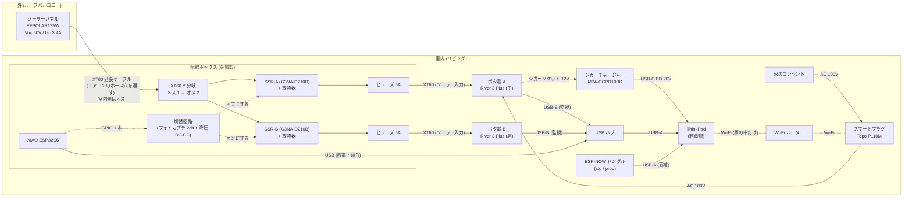
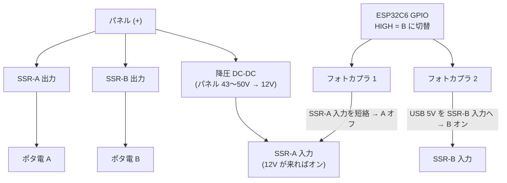

# 電源システム設計 (ソーラー + ポタ電 2 台 + ThinkPad)

FarmVerse サーバー (ThinkPad) を、ベランダのソーラーパネルと 2 台の EcoFlow River 3 Plus で動かす。
実装は [power/](../../power/) サブプロジェクト。

## 1. 目的と優先順位

1. **ThinkPad (制御層) を止めない。** ポタ電 A は ThinkPad 専用で、絶対に空にしない
2. **安全** (火災・感電・機器の破損を起こさない)。制御が壊れたときは安全側 (A に給電) に倒れる
3. **ソーラーの電気を捨てない。** A が満タンのときの余りを ThinkPad の内蔵バッテリーとポタ電 B に回す
4. 家の電気 (系統) は A の電池切れを防ぐ最後の手段として使う

## 2. 前提 (実測・仕様)

| 項目 | 値 | 出典 |
|---|---|---|
| パネル | EcoFlow EFSOLAR125W (両面)。Voc 50V、Vmp 43V、Isc 3.4A (BNPI) | EcoFlow ユーザーマニュアル |
| ポタ電 | EcoFlow River 3 Plus × 2 (A: 主、B: 副)。各 286Wh | |
| ThinkPad 本体の消費 | 3.8〜5.3W | 2026-11-23 バッテリー駆動中の実測 |
| A から出ていく量 (AC 出力 + Lenovo アダプター経由) | 約 11.7W (AC 出力の表示は約 8.2W) | 2026-11-22〜23 夜間の残量の減り方から |
| A は 0% で AC 出力を止め、充電が戻っても自動でオンにならない | | 2026-11-23 に発生 |
| A の AC 出力のオン・オフを NUT から操作できない (instcmd は shutdown 系のみ) | | `upscmd -l` |
| 1 枚のパネルに 2 台の MPPT を並列につなぐと、互いの MPPT が干渉して最適点に収束しない | | DIY Solar Forum (下記参考) |

## 3. 配線 (全体)

- **ポタ電 B は ThinkPad に給電しない。** ThinkPad の電源系統はポタ電 A だけにして単純にする。B は夏の余剰を貯める 2 台目の蓄電池で、停電時の予備・ほかの機器の電源にする
- **交流の電源を 2 つ、1 本の線に合流させない** (系統とポタ電の出力をソフトで切り替える配線は採用しない)
- ポタ電 A の AC 出力は冬は使わない (待機の損失をなくす)。ThinkPad は DC (シガーソケット) から給電する

## 4. パネルの切替回路 (A か B のどちらか一方)

2 台の MPPT を並列につなぐと干渉するため、**パネルは常にどちらか一方だけ**につなぐ。

| 状態 | GPIO | SSR-A | SSR-B | パネルの行き先 |
|---|---|---|---|---|
| 通常 | LOW | オン | オフ | A |
| B へ振り分け | HIGH | オフ | オン | B |
| ESP32 / ThinkPad / USB が死んでいる | (出力なし) | **オン** (パネル自身の電気で入る) | オフ | **A** |
| 夜 (発電なし) | どちらでも | オフ | オフ | なし |

- **A 側は「パネルの電気でオン、制御がオフにしたときだけ切れる」。** 制御のどこが壊れても A に給電される (フェイルセーフ)
- **1 本の GPIO で A オフと B オンを同時に切り替える。** ソフトのバグで A と B が同時にオン (MPPT の並列) になることがない (ハードウェアでの相互排他)
- 機械式リレーではなく **SSR (半導体リレー) で直流 50V を切る。** 機械接点は直流 50V・3.4A を切るとアークが出る。G3NA-D210B は DC 5〜200V・10A 定格 (放熱器なしで 4A、40℃)
- SSR のオン電圧降下は最大 1.5V → 3.4A で約 5W の発熱。放熱器を付け、金属製のボックスに入れる

## 5. 制御ルール

ThinkPad 上の常駐プログラム (`power/manager`) が 30 秒ごとに判断する。上から順に評価する。

| 優先 | 条件 | 動作 |
|---|---|---|
| 1 | A の残量 ≤ 15% | プラグ 1 をオン (系統で A を充電)。30% まで戻ったらオフ。パネルは A |
| 2 | ThinkPad の内蔵バッテリー < 40% | 40% まで充電 (停電への備え) |
| 3 | A ≥ 95% かつソーラーが余っている | まず ThinkPad を 80% まで充電。満ちたらパネルを B に切替。A が 90% まで下がるか、B が満タンなら A に戻す |
| 4 | それ以外 | パネルは A、プラグ 1 はオフ、ThinkPad は充電しない (今の残量を保つ) |

- 切替の往復を防ぐため、閾値にヒステリシスを持たせ、切替後 10 分は戻さない
- 常駐プログラムが止まったら: ESP32 は ThinkPad から一定時間 (例: 2 分) 命令が来なければ GPIO を LOW (パネルは A) に戻す。プラグ 1 は「電源復帰時オン」に設定する
- 通知: A の残量低下、A の AC / DC 出力の停止、ThinkPad のバッテリー駆動、切替・プラグ操作の失敗

## 6. 防火・安全対策

| 対策 | 内容 |
|---|---|
| 配線ボックス | **金属製** (鋼板) にする。Y 分岐・SSR・ヒューズ・切替回路・ESP32 をまとめて入れる。ケーブルはグランド (ケーブル用の穴の部品) を通し、引っ張っても端子に力がかからないようにする |
| ヒューズ | A・B それぞれのソーラー入力の手前に 5A。パネルの電流は最大 3.4A なので通常は切れない。ポタ電側からの逆流など配線の故障を想定 |
| 置き場所 | ポタ電 2 台とボックスは、燃えにくい面 (タイル・金属の台など) の上に置く。カーテンや紙類から離し、ポタ電の吸排気口をふさがない |
| ポタ電はボックスに入れない | 充電中に発熱するため、風通しを優先する |
| 火災警報器 | ポタ電の近くに住宅用火災警報器 (煙式) を付ける |
| 極性 | XT60 は差し込みの向きが決まっているが、自作の配線では極性を必ずテスターで確認してからつなぐ |
| 雨・結露 | 屋外にあるのはパネルと延長ケーブルだけ。ホース穴はパテでふさぎ、ケーブルは穴の手前で一度下に垂らす (水が伝って入らないようにする) |

## 7. 未確定事項・試験

1. **パネル 1 枚をポタ電 2 台に並列でつないだときの振る舞い** (§4 で並列をやめたので不要になったが、参考として手元で確認する場合は短時間・監視しながら行う)
2. ThinkPad X395 が MPA-CCPD10BK (PD 45W) から安定して給電されるか
3. G3NA-D210B の発熱 (3.4A 連続でボックス内の温度がどこまで上がるか)
4. River 3 Plus のソーラー入力が SSR 越し (電圧降下 1.5V) でも MPPT が正常に動くか
5. SSR の漏れ電流 (最大 5mA) がオフ側のポタ電の入力に影響しないか

## 8. 段階

| 段階 | 内容 | 必要な部品 |
|---|---|---|
| 1 | 電池切れ防止 (系統のスマートプラグ) と DC 給電 | Tapo P110M、MPA-CCPD10BK |
| 2 | ポタ電 B の監視 | USB ハブ、USB-A to B ケーブル |
| 3 | パネルを傾ける (南向き、冬 45° / 夏 20°) | 直管 25.4: 800mm × 2 (レール)、900mm を 750 + 150 にカット × 2 (つっかえ棒)。自在クランプ × 6、ミニクラ × 2、ステンレスのシャコ万力 × 4、EPDM ゴムシート |
| 4 | パネルの A / B 切替 | 配線ボックス一式 (SSR × 2 など) |

## 参考

- [EcoFlow 125W Bifacial Modular Solar Panel User Manual](https://www.santansolar.com/wp-content/uploads/EcoFlow-125W-Bifacial-Modular-Solar-Panel_User-Manual_en.pdf)
- [DIY Solar Forum: One 400W solar panel to 2 power stations?](https://diysolarforum.com/threads/one-400w-solar-panel-to-2-power-stations.85857/)
- [オムロン G3NA-D210B-UTU DC5-24](https://www.fa.omron.co.jp/product/item/G3NA-D210B-UTU_DC5-24/)
- [python-kasa Supported devices](https://python-kasa.readthedocs.io/en/stable/SUPPORTED.html)
